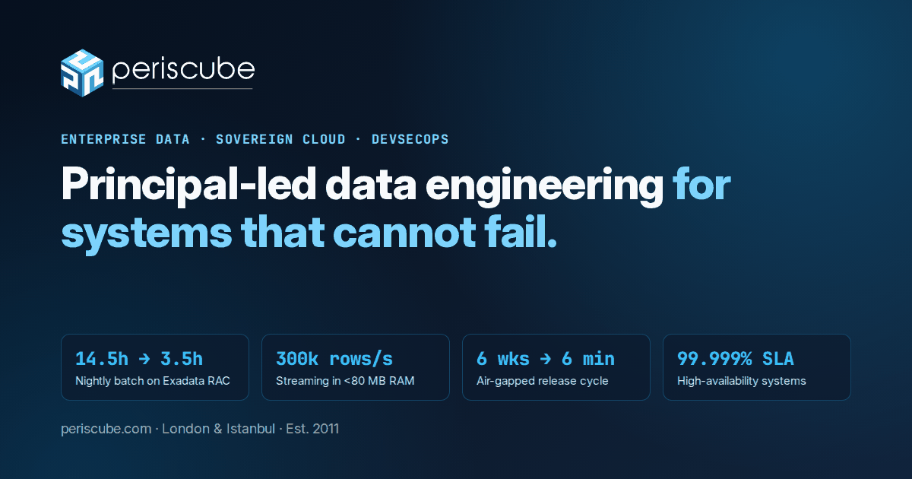

  

# Periscube (`periscube.com`)

**Principal-Led Data Engineering, Sovereign AI Data Centers, Self-Hosted Blackwell/Hopper LLM Inference & Air-Gapped DevSecOps for Mission-Critical Enterprises.**

Periscube (**Periscube Ltd.**, Company No. `07691565`, Registered in England & Wales, Est. 4 July 2011) is a principal-led enterprise architecture and engineering consultancy operating from **London** and **Istanbul**.
Our Principal Architects and Engineers design, rescue, and govern petabyte-scale data platforms, sovereign cloud control planes, and high-throughput open-weight AI clusters across **Global Financial Services**, **Tier-1 Telecommunications**, **Defense & Public Sector**, **Global Retail**, and **Rail/Mobility**.
Our practice pairs 20+ years of verified global delivery with **Boğaziçi University** (`Top 0.04% nationwide - Management Information Systems & Engineering Practice`), **London City University** (`International Finance`), **National & Regional Mathematics Olympiad Medalist**, **TOGAF 9.1**, **dbt Labs**, and **dlt 2025** accreditations.

---

## Core Architectural Practices & Open IP

| Practice Domain | Core Engineering Stack, Regulatory Standards & Capabilities |
| :--- | :--- |
| **Sovereign AI Data Centers & Multi-Jurisdictional Compliance** | `8MW-to-64MW` Direct-Liquid-Cooled (`~1.20 PUE`) `InfraCo / PlatCo` control-plane separation, `US CLOUD Act` & `US BIS` GPU compliance, `EU GDPR / AI Act / DORA / CADA SEAL-3 / SecNumCloud / C5 / EU Data Act ($0 egress)`, `Turkish KVKK 6698-7499 / Law 7545 / BDDK`, `CPU/GPU Confidential Computing (TEEs, HSM)`, and inline `KVKKVault` PII tokenization airlocks. |
| **Self-Hosted LLM Inference & Token Economics** | Dedicated `NVIDIA Blackwell B200` and `Hopper` GPU clusters, hardware-aware `NVFP4 / FP8` quantization (`~35%` lower GPU memory), `TP4-to-TP8` tensor parallelism (`NVLink / HBM3e`), `>85%` KV prefix caching, chunked prefill, speculative decoding, and the `tokener` zero-retention `OpenTelemetry` FinOps gateway. |
| **Periscube Data Framework & Enterprise Lakehouses** | Four integrated engines (`DataVault Accelerator` for up to 40% faster initial DWH builds, `DataOps & Observability Engine`, `Hybrid Sync Connector`, `Periscube Decision Studio` 3-second KPI cockpits), `TOGAF 9.1`, `Data Vault 2.0 / 2.1`, `TM Forum SID (GB922)`, `dbt Core / Cloud`, `Snowflake`, `DuckDB`, and `Polars`. |
| **Extreme Database Rescue & Cloud FinOps** | 10-node `Oracle Exadata 19c/23ai RAC` deep tuning (`DBRM v5`, non-invasive CBO SQL patches, `32M/64M` temp tablespaces, `16-bucket` hash staging, `HyperLogLog` bulk stats), monolithic `MS SQL Server` offloading, and multi-cloud `AWS / GCP / Snowflake` FinOps audits. |
| **High-Throughput Streaming & Industrial IoT** | Memory-bounded (`<80 MB RSS`) `PyArrow` C++ zero-copy streaming at `300,000+ rows/sec` (`Celery 5.6+`, `Redis 8.x`, Linux `inotify`) and `50M+ files/day` rail and industrial telemetry pipelines on `Amazon EKS` (`InfluxDB`, `Grafana`). |
| **Air-Gapped DevSecOps & Agentic Developer OS** | Pre-accredited `HashiCorp Packer` Golden AMIs, `Terraform` IaC, `Harbor` offline registries, hermetic offline `uv` registries, `systemd` sandboxing (`ProtectSystem=strict`), automated SAST/SBOM gates, plus `FastMCP` toolchains (`oracle-exadata-axi`, `tmforum-sid-auditor`, `3nf-db-auditor`) driving a `10x` engineering productivity multiplier. |

---

## Audited Production Benchmarks

- **78% Faster LLM Time-to-First-Token & Order-of-Magnitude Token Cost Compression:** Tuned open-weight LLM inference clusters on `NVIDIA Blackwell B200` and `Hopper` GPUs (`>15s to 3.3s` TTFT under a `50%+` concurrency surge, `120+ to 450+ tokens/sec`, `>85%` KV prefix cache hit rates, and `80%+` 24-hour GPU utilization) with zero external data retention.
- **99.999% Availability & +40% Exadata Headroom:** Eliminated `99.9%` of `resmgr:cpu quantum` waits, uncaged `512` parallel hardware threads, eliminated `18.6 TB/day` temp spills, and cut nightly batch turnaround by `5.0 hours/day` across a 10-node `Oracle Exadata 19c RAC` cluster (`50M+` subscriber scale) with zero hardware CapEx (`Oracle Innovation Award`).
- **300,000+ Rows/Sec Zero-Copy Streaming (76% Duration Reduction, >4x Faster):** Compressed daily `20 TB` compressed file ingestion (`200,000` files/day, `>20.5B` records) from `14.5 hours to 3.5 hours` inside an `<80 MB RSS` RAM envelope using `1/10th` the CPU, RAM, and storage footprint.
- **6 Weeks to 6 Minutes Release Velocity (>1,000x Speedup):** Pre-accredited `Packer` Golden AMIs and `Amazon EKS` pipelines across a `£1.6B` UK commuter rail IoT program (`50M+` sensor files/day).
- **~22% Multi-Cloud Spend Recovery & Over £1,000,000/yr License Savings:** Uncovered `~22%` orphaned `AWS / GCP` spend during a `$5B` private equity M&A transition and saved over `£1,000,000 per annum` in UK emergency-services `Oracle` licensing via hard-isolated cluster design.
- **20x National Tax Platform Scaling (5 to 100+ Offices):** Re-architected distributed OLTP/analytical database partitioning and CI/CD pipelines for `900%` faster transactions and `200%` faster builds (`Techno Brain Group Company Innovation Award`).

---

## Fixed-Scope Commercial Value Ladder

Every Periscube engagement operates on bounded deliverables, fixed pricing, and 100% client IP ownership - never open-ended hourly staff augmentation:

All service fees are fixed and quoted in British Pounds (`GBP`, `£`).

1. **Free Dual-Track Executive Self-Audit Scorecard (`£0`):** Choose Track A (`15-Point Exadata, Snowflake & Data Vault 2.1 Waste Scorecard`) or Track B (`Sovereign & Self-Hosted Blackwell/Hopper LLM Unit Economics & Compliance Readiness Scorecard`) - [periscube.com/offers/exadata-finops-auditor](https://periscube.com/offers/exadata-finops-auditor/)
2. **5-Day Read-Only Forensic Diagnostic (`£7,500` fixed):** Diagnosis only on 1 track (`Database & Lakehouse FinOps` or `Sovereign Blackwell/Hopper LLM Unit Economics`), delivering a quantified waste and latency dossier plus a Board-ready 90-day Remediation Architecture Blueprint (ADR), backed by a **5x Verified Annual Savings Guarantee** (`>= £37,500/year` or a 100% refund) - [periscube.com/offers/5-day-exadata-diagnostic](https://periscube.com/offers/5-day-exadata-diagnostic/)
3. **28-Day Fixed-Scope Production Sprint (`£30,000` fixed, `£22,500` net after Tier 2 credit):** Solves 1 bounded bottleneck across `Exadata DBRM & SQL SLA Rescue`, `Governed Data Vault 2.1 + dbt/DuckDB`, `Self-Hosted Blackwell/Hopper LLM Inference`, or `Air-Gapped DevSecOps` - [periscube.com/offers/4-week-pilot-sprint](https://periscube.com/offers/4-week-pilot-sprint/)
4. **Principal Design Authority & Automated Governance Retainer (`£9,000/month`):** Automated `<60-second` CI/CD schema, 3NF, Data Vault, and token gates, `48-hour` async ADR sign-off, and a Monthly Executive Briefing, capped at 3 active enterprise retainers globally - [periscube.com/offers/principal-retainer](https://periscube.com/offers/principal-retainer/)
5. **Strategic Enterprise & Consortium Architecture Mandate (from `£45,000`):** `8MW-to-64MW` DLC Sovereign AI Data Center `InfraCo / PlatCo` blueprints, multi-jurisdictional confidential computing, and multi-billion-dollar PE M&A technical diligence - [periscube.com/pricing](https://periscube.com/pricing/)

---

## Connect With Our Principal Architects

- **Website:** [https://periscube.com](https://periscube.com)
- **Audited Case Studies:** [https://periscube.com/case-studies/](https://periscube.com/case-studies/)
- **AI & LLM Technical Dossier (`llms.txt`):** [https://periscube.com/llms.txt](https://periscube.com/llms.txt)
- **Corporate Identity & ISO/IEC 27001 Security:** [https://periscube.com/information-security-policy/](https://periscube.com/information-security-policy/)
- **Direct Executive Intake:** [https://periscube.com/contact/](https://periscube.com/contact/)
- **LinkedIn:** [https://www.linkedin.com/company/periscube](https://www.linkedin.com/company/periscube)
- **Email:** [hello@periscube.com](mailto:hello@periscube.com)
