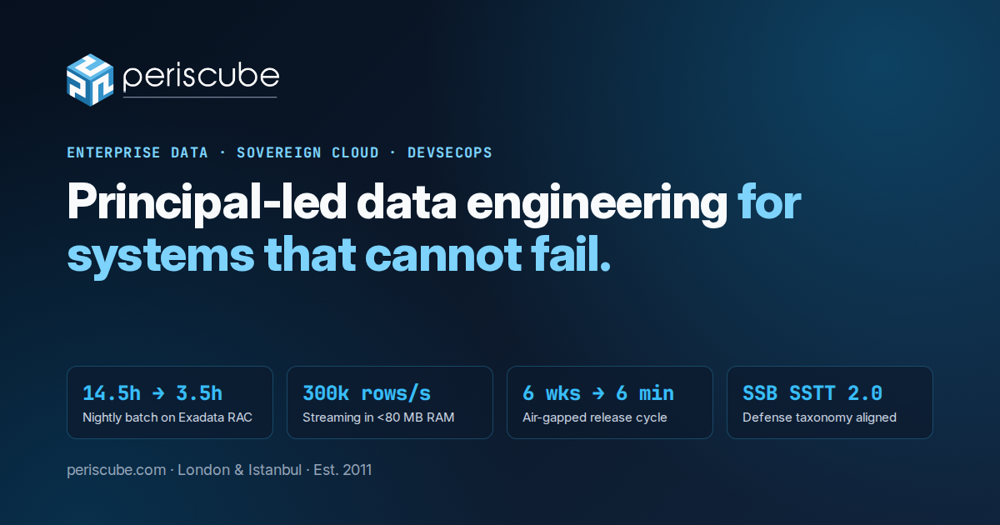

  

# Periscube (`periscube.com`)

**Principal-Led Data Engineering, Sovereign Cloud & Air-Gapped DevSecOps Architecture for Mission-Critical Enterprises.**

Periscube is an elite, principal-led Enterprise Data Engineering, High-Availability Cloud/On-Prem Architecture, and Air-Gapped DevSecOps consultancy operating from **London** and **Istanbul**.
Founded in London (**Periscube Ltd, Est. 2011**) with global engineering hubs in London and Istanbul, we architect, rescue, and operate petabyte-scale data platforms and sovereign cloud infrastructure across **Defense & Aerospace**, **Tier-1 Telecommunications**, **Global Investment Banking**, and **Rail/Mobility**.

---

## Defense & Enterprise Capabilities Matrix (SSB SSTT 2.0 Aligned)

| SSTT 2.0 Code | Domain | Core Engineering Stack & Capabilities |
| :--- | :--- | :--- |
| **A09.01** | **Data & Information Management** (`Veri ve Bilgi Yönetimi`) | High-availability enterprise data warehousing (`Oracle Exadata 19c/23ai RAC`, `Snowflake`, `DuckDB`), `Data Vault 2.1`, `TM Forum SID (GB922)`, and high-throughput ELT/ETL (`ODI 12c`, `dbt`, `Apache Airflow`). |
| **B13.02** | **Big Data Analytics** (`Büyük Veri Analitiği`) | `300,000+ rows/sec` zero-copy `PyArrow` C++ streaming ingestion, executive BI (`Oracle Analytics Server / OAS`), and governed Text-to-SQL / MCP semantic data workflows. |
| **B14.07 & B14.12** | **Application (DevSecOps) & Container Security** | Air-gapped CI/CD pipeline design, automated SAST/DAST/SBOM gates, ephemeral developer sandboxes, `Terraform` IaC, CIS-hardened `Packer` Golden AMIs, and `Kubernetes` orchestration. |
| **B13.01 & A08.04** | **Private Cloud & Distributed Architectures** | Sovereign on-premise cloud infrastructure, dynamic load balancing, fault-tolerant distributed systems, and high-concurrency database rescue (`Advanced DB Resource Management Plans`). |
| **B14.05 & B09.12** | **Data Security & Middleware Systems** | Database security (`TDE`, immutable auditing, static/dynamic PII data masking), DLP, and high-throughput message-oriented middleware (`Apache Kafka`, `DDS`). |
| **B09.10 & C07.20** | **Operational Telemetry & Condition Monitoring** | Sub-second sensor, rail, and avionics time-series telemetry ingestion, columnar storage, and anomaly detection backends for predictive maintenance. |

---

## Verified Production Benchmarks

- **99.999% Availability & +40% Database Headroom:** Tuned 10-node `Oracle Exadata 19c RAC` clusters via **Advanced DB Resource Management Plans** and non-invasive CBO SQL Patches, cutting `resmgr:cpu quantum` waits by **99.9%** and freeing **512 parallel threads** with zero hardware spend.
- **300,000+ Rows/Sec Zero-Copy Streaming:** Engineered a memory-bounded (`<80 MB RAM`) `PyArrow` C++ streaming loader that compressed overnight enterprise data warehouse loads from **14.5 hours to 3.5 hours**.
- **6 Weeks to 6 Minutes Release Velocity:** Automated air-gapped developer sandboxes and reproducible CI/CD pipelines using `Packer`, `Terraform`, and `Kubernetes`.
- **25% - 40% Cloud & Licensing FinOps Savings:** Eliminated compute and licensing waste across `Snowflake`, `BigQuery`, `AWS`, and `Oracle` estates within fixed 4-week pilots.

---

## Connect with a Principal Architect

- **Website (English):** [https://periscube.com](https://periscube.com)
- **Website (Türkçe):** [https://periscube.com/tr/](https://periscube.com/tr/)
- **SSB SSTT 2.0 Matrix:** [https://periscube.com/sstt/](https://periscube.com/sstt/)
- **Corporate Identity & Information Security:** [https://periscube.com/kurumsal/](https://periscube.com/kurumsal/)
- **LinkedIn:** [https://www.linkedin.com/company/periscube](https://www.linkedin.com/company/periscube)
- **Book a 30-Minute Executive Call:** [https://calendly.com/periscube/30min](https://calendly.com/periscube/30min)
- **Email:** [hello@periscube.com](mailto:hello@periscube.com)
